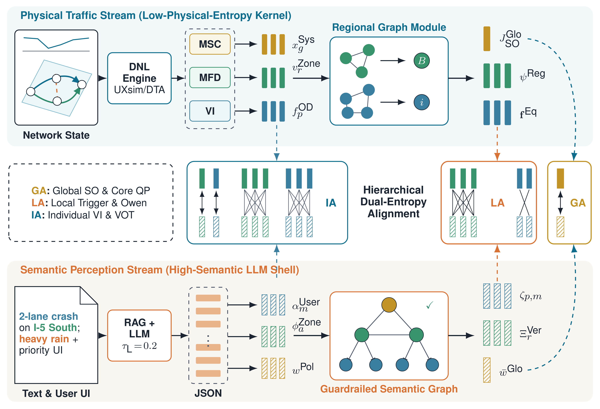
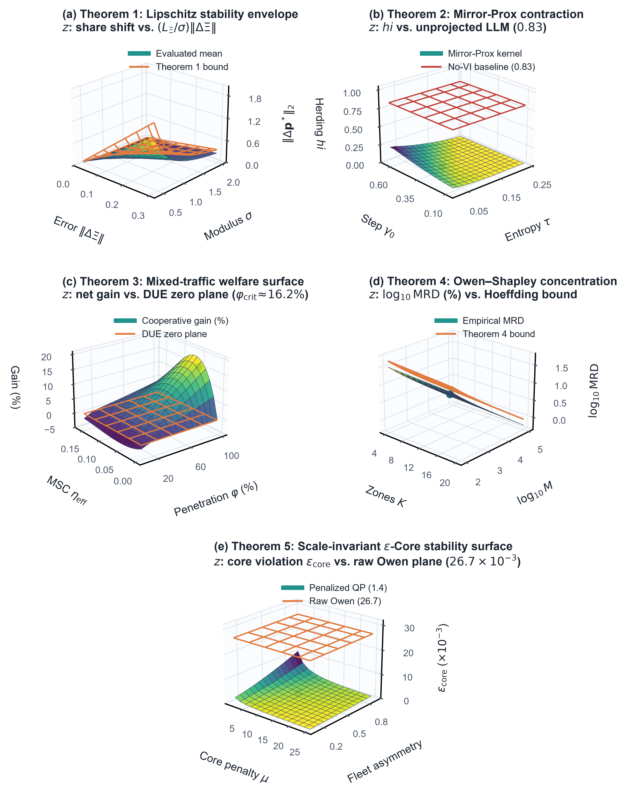

<div align="center">

# When Language Meets Equilibrium: NashCo-LLM

**Decoupling Semantic Reasoning from Game-Theoretic Control in Dynamic Traffic Assignment**

[](https://www.sciencedirect.com/journal/transportation-research-part-c-emerging-technologies)
[](https://www.python.org/)
[](LICENSE)
[](verification/interactive_3d_theorems.html)

**Wen-Dong Jiang**, **Zijun Wu\***, and **Jiancheng Long**  
*School of Automotive and Transportation Engineering, Hefei University of Technology, Hefei 230009, Anhui, China*  
\*Corresponding author: `zijun.wu@hfut.edu.cn`

</div>

---

## Overview

**NashCo-LLM** is a dual-entropy, four-layer hierarchical framework in which **mathematical optimization serves as the structured communication protocol among heterogeneous traffic agents** under unstructured non-recurrent disruptions. Rather than asking large language model (LLM) agents to bargain over vehicle routes in verbose natural text—which triggers correlated herding, context overflow, and real-time latency failure—NashCo-LLM structures inter-agent communication across two complementary channels:

1. **Semantic-to-Physical Signal Distillation (Layer 4 & Layer 2):** A disjunctive event trigger ($\Delta_r^{\text{phys}}(t) > 0.12 \lor \text{NewTextEvent}_r(t)$) activates regional RAG-LLM parsers only when localized speed anomalies or geofence-matched dispatches arrive. Raw human dispatches are distilled into compact perturbation signals vetted by a deterministic **four-gate physical guardrail** (with single-pass reflection retry and physics-prior fallback) before being broadcast across affected zones inside $\mathcal{D}_\Xi$.
2. **Optimization-Mediated Negotiation, Dual Signaling, and Trust Settlement (Layer 3 & Layer 1):** Instead of noisy text debate, OD clusters and commercial fleets negotiate normalized path shares through **damped composite Mirror-Prox variational inequality (VI) updates** that guarantee contracting consensus. A global coordinator communicates cross-agent congestion externalities via **marginal social cost (MSC) mobility-credit duals** (with external-only atomic fleet rates) and sustains inter-agent trust through **two-level stratified Owen–Shapley settlement** projected onto the **scale-invariant penalized $\varepsilon$-core** at zero external subsidy.

<p align="center">
  
  <br/>
  <em>Figure 2: Dual-stream four-layer hierarchical alignment architecture of NashCo-LLM (IA, LA, and GA bridges).</em>
</p>

---

## Key Theoretical & Empirical Highlights

- **Five Analytical Guarantees (`verification/verify_theorems_3d.py` & `interactive_3d_theorems.html`):**
  - **Theorem 1:** Strictly interior equilibrium existence, Robinson strong regularity, and local Lipschitz stability under bounded semantic error.
  - **Theorem 2:** Demand-weighted Bregman KL geometric contraction $(1 + \gamma \tau_{\min}^{\text{eff}})^{-s}$ in the block-weighted $\ell_2/\ell_1$ norm and herding suppression ($hi = 0.061$ vs. $0.83$ without projection).
  - **Theorem 3:** Exact heterogeneous-VOT potential alignment for non-atomic users and atomic commercial fleets, second-best potential $P_\eta(\mathbf{x})$, and mixed-traffic critical penetration $\varphi_{\text{crit}} \approx 16.2\%$.
  - **Theorem 4:** Unbiased stratified Owen–Shapley estimation in $O(M|\mathcal{M}||\mathcal{A}|)$ with exact-span Hoeffding concentration at $O(M^{-1/2})$.
  - **Theorem 5:** Exact scale-invariant penalized $\varepsilon$-core QP uniqueness ($\delta_{\text{qp}} = 10^{-3} v(\mathcal{M})/|\mathcal{M}|$), exact on-equilibrium budget balance, Pareto individual rationality, and zero-transfer cold-start feasibility.

<p align="center">
  
  <br/>
  <em>Figure 5: Formula-driven 3D numerical verification of Theorems 1–5 (open <code>verification/interactive_3d_theorems.html</code> in any browser for rotatable WebGL exploration).</em>
</p>

| Benchmark Tier / Network | Links / ODs / Trips | TSTT vs. DUE | DSO Gap | Sync. Latency (300 s step) | Core Violation $\varepsilon_{\text{core}}$ |
| :--- | :---: | :---: | :---: | :---: | :---: |
| **Tier 1:** Braess / Two-Fleet | 5 / 1 / 4k & 2 / 1 / 6k | PoA `1.005` / `1.001` | `0.47%` / `0.06%` | `< 0.1 s` | `0.0001` / `0.0004` |
| **Tier 3:** Sioux Falls (SF) | 76 / 528 / 360.6k | **`+15.35%`** | `3.60%` | **`2.70 s`** (`0.9%`) | **`1.4e-3`** (`99.2%` PIR) |
| **Tier 3:** Anaheim (ANA) | 914 / 1,406 / 104.7k | **`+16.09%`** | `4.02%` | **`3.40 s`** (`1.1%`) | — |
| **Tier 4:** Chicago Sketch (CHI) | 2,950 / 93,135 / 1.26M | **`+17.31%`** | `4.18%` | **`5.10 s`** (`1.7%`) | — |
| **Case C:** 6 Unseen Disruptions | Zero-shot (out-of-RAG) | **`+41.1%`** First-30m | — | `2.70 s` (`0.90 s` on 8B) | `0.0%` post-fallback violation |

---

## Repository Structure (1-to-1 Paper Mapping)

```text
PaperCodeTR-C/
├── configs/
│   ├── default.yaml                         # Table 4(b) default hyperparameters
│   ├── benchmarks.yaml                      # Table 4(a) four-tier networks & Case C categories
│   └── prompts.yaml                         # Appendix A verbatim prompts & Case A JSON payload
├── src/nashco_llm/
│   ├── config.py                            # Typed configuration dataclasses (Table 2 & 4b)
│   ├── types.py                             # PerturbationTensor (\Xi), LinkState, 7-field JSON
│   ├── pipeline.py                          # Algorithm 1: Online rolling-horizon control loop
│   ├── layer1_coordinator/
│   │   ├── msc_pricing.py                   # Sec. 3.3.1: Eqs. (12)-(15) MSC pricing & adaptive \eta_eff(\rho)
│   │   ├── owen_shapley.py                  # Sec. 3.3.2: Eqs. (16)-(18) fast surrogate & stratified Owen
│   │   └── core_clearing.py                 # Sec. 3.3.2: Eqs. (19)-(22) penalized \varepsilon-core QP & Remark 1
│   ├── layer2_regional/
│   │   ├── mfd_partitioner.py               # Sec. 3.1: K-zone METIS/MFD partitioning & fleet anchor r*(q)
│   │   └── event_trigger.py                 # Sec. 3.1: Eqs. (1)-(2) top-q speed anomaly & gazetteer gate
│   ├── layer3_equilibrium/
│   │   ├── traffic_cost.py                  # Sec. 3.2.2: Eqs. (4)-(5) semantic-augmented link/path cost
│   │   └── mirror_prox_vi.py                # Sec. 3.2.2: Eqs. (6)-(10) 4-class VI & composite Mirror-Prox
│   ├── layer4_semantic/
│   │   ├── rag_retriever.py                 # Sec. 3.2.1: text-embedding-3-small + FAISS (top-8, cos >= 0.78)
│   │   ├── schema_guardrail.py              # Sec. 3.2.1 & Table 3: 7-field schema + 4-gate guardrail Eq. (3)
│   │   ├── llm_parser.py                    # Sec. 3.2.1 & Appendix A: GPT-4o / vLLM Llama-3.1 + 1-pass retry
│   │   └── dual_calibrator.py               # Sec. 3.2.2: Eq. (11) 3-period projected behavioral calibrator
│   ├── simulators/
│   │   ├── base.py                          # Unified DNL interface \Lambda(f; \Xi)
│   │   ├── bpr_analytical.py                # Built-in analytical BPR engine (Tier 1 & offline tests)
│   │   ├── uxsim_adapter.py                 # Sec. 4.2: UXsim 1.7.1 mesoscopic adapter (Tiers 1-3)
│   │   ├── dtalite_adapter.py               # Sec. 4.2: DTALite 3.8 / Path4GMNS 0.9.6 adapter (Tier 4 CHI)
│   │   └── sumo_traci_adapter.py            # Sec. 4.2 & 5.4: SUMO 1.21.0 TraCI adapter (5% SF subarea)
│   └── evaluation/
│       ├── metrics.py                       # Sec. 4.3: TSTT, PIR, Gini, MRD, Cohen's d, Cliff's \delta, Holm
│       └── baselines.py                     # Sec. 4.3: Registry of 12 published 2025-2026 baselines
├── experiments/
│   ├── run_tier1_analytical.py              # Sec. 5.1: Braess & Two-Fleet verification (Table 5a)
│   ├── run_benchmark.py                     # Sec. 5.2-5.3: Cross-scale SF / ANA / CHI benchmarks (Tables 6-9)
│   ├── run_sumo_audit.py                    # Sec. 5.4: Calibrated microscopic SUMO audit (Table 10)
│   ├── run_ablation_sensitivity.py          # Sec. 6: Ablations A1a-A6, 6x6 \varphi grid, \rho & K/M sweeps
│   └── run_case_studies.py                  # Sec. 7: Case Studies A, B, C (zero-shot), and D
├── verification/
│   ├── verify_theorems_3d.py                # Sec. 3.5: Formula-driven 3D surfaces for Theorems 1-5 (Fig. 5)
│   └── interactive_3d_theorems.html         # Sec. 3.5: Browser-based interactive WebGL 3D explorer
├── tests/
│   └── test_smoke.py                        # End-to-end automated verification of Layers 1-4 & Theorems 1-5
└── assets/                                  # High-resolution paper architecture & 3D theorem previews
```

---

## Quick Start

### 1. Installation

```bash
git clone https://github.com/7WD1/PaperCodeTR-C.git
cd PaperCodeTR-C
pip install -r requirements.txt
pip install -e .
```

Optional backends for full metropolitan reproduction:
- **Solvers:** `gurobipy>=12.0.1` (or open-source `osqp` / `scipy`)
- **Simulators:** `uxsim>=1.7.1`, `path4gmns>=0.9.6`, and `SUMO 1.21.0` (`traci`)
- **LLM & Retrieval:** `openai>=1.55.0`, `vllm>=0.6.2`, `faiss-cpu>=1.8.0`, `langgraph>=0.2.45`

### 2. Run End-to-End Verification Suite (Zero External Dependencies)

```bash
python tests/test_smoke.py
python experiments/run_tier1_analytical.py --gamma0 0.35 --owen-samples 500
python experiments/run_case_studies.py --case C
```

### 3. Reproduce 3D Theorem Verification & Interactive Explorer

```bash
python verification/verify_theorems_3d.py
```

Open [`verification/interactive_3d_theorems.html`](verification/interactive_3d_theorems.html) directly in any modern browser to interactively adjust $(L_\Xi, \tau, \gamma_0, \eta_{\text{eff}}, \varphi, K, \mu)$ and inspect real-time KPI surfaces for Theorems 1–5.

### 4. Full Metropolitan Benchmarks & Ablations

Download the public road networks from [TNTP](https://github.com/bstabler/TransportationNetworks) into `data/tntp/` and launch:

```bash
python experiments/run_benchmark.py --network sioux_falls --seeds 1 2 3 4 5 6 7 8 9 10
python experiments/run_ablation_sensitivity.py --mode ablation
python experiments/run_sumo_audit.py --ttc 1.5
```

---

## Citation

If you find this framework or codebase useful in your research, please cite:

```bibtex
@article{jiang2026nashcollm,
  title   = {When Language Meets Equilibrium: Decoupling Semantic Reasoning from Game-Theoretic Control in Dynamic Traffic Assignment},
  author  = {Jiang, Wen-Dong and Wu, Zijun and Long, Jiancheng},
  journal = {Transportation Research Part C: Emerging Technologies},
  year    = {2026},
  note    = {Code available at \url{https://github.com/7WD1/PaperCodeTR-C}}
}
```

## License

This project is released under the [MIT License](LICENSE).
